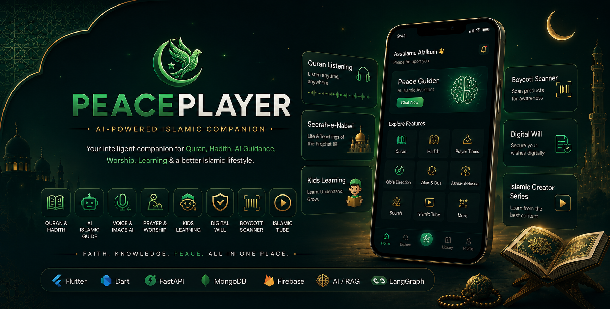

[Back to all projects](../README.md)

# PeacePlayer: AI-Powered Islamic Companion

**Role:** Full Stack AI Engineer · **Period:** [start] to [end] · **Status:** [In progress / Completed] · **Code:** Private

## Problem

Users needed reliable, source-based Quran and Hadith guidance in one mobile app.

## Solution

- Complete Quran, translations, tafsir, audio recitation and authentic Hadith on MongoDB
- Peace Guider: multimodal RAG assistant with vector embeddings, LLM answers and Islamic source grounding
- Islamic Tube, Quran Listening, Worship, Life Guidance, Seerah, Kids, Digital Will and Boycott Scanner
- Firebase Auth, cloud infrastructure, Docker, AI agents and an optimized FastAPI backend

## Tech stack

## Result

[fill in: users, performance or outcome]

## Screenshots and demo

[Demo video](YOUR-VIDEO-LINK) · [Upwork portfolio entry](YOUR-UPWORK-PROJECT-LINK)

> Source code is private.
